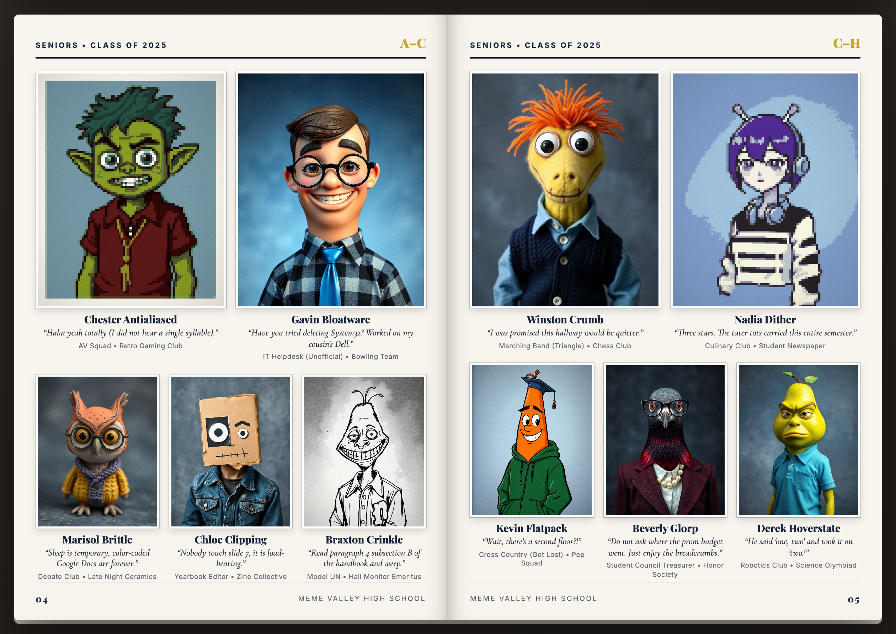

# Meme Valley High School — Class of 2025

Local AI pipeline for generating an original **Gumball-style mixed-media Meme Yearbook** on Apple Silicon using **LM Studio** (world-building & roster) + **`mflux`** (native MLX image generation) + a print-ready **HTML Yearbook**.

<p align="center">
  
  <br />
  <em>Sample two-page spread (Seniors A–C &amp; C–H): 10 original mixed-media meme characters generated locally with LM Studio + mflux.</em>
</p>

## Setup

1. Install Python dependencies (including [`mflux`](https://github.com/filipstrand/mflux), which runs image models directly in-process on Apple Silicon MLX with no server or API token needed):
   ```bash
   uv sync
   ```
2. For generating new student rosters locally, install [LM Studio](https://lmstudio.ai/) with its `lms` CLI and a local MLX model (for example `qwen3-vl-30b-a3b-instruct-mlx`). Load the model before running `generate_roster.py`:
   ```bash
   lms load qwen3-vl-30b-a3b-instruct-mlx
   ```
   *(By default `generate_roster.py` talks to LM Studio via `lms chat`—no API token or `.env` file needed!)*

## Pipeline Commands

### 1. Generate or append students via LM Studio (`lms chat`)
```bash
# Append 100 new unique seniors while keeping existing students + Principal
uv run python scripts/generate_roster.py --count 100 --append

# Unload the LLM to free unified memory before local image generation
lms unload --all
```
*(Or pass `--backend http` if you prefer LM Studio's OpenAI-compatible HTTP endpoint on `localhost:1234`.)*

### 2. Generate portraits locally with MLX (`mflux`)
Fast start using `FLUX.1-schnell` 4-bit + pixel-art LoRA (automatically skips portraits that already exist):
```bash
uv run python scripts/generate_portraits.py --model schnell-4bit --variants 1
```

Or try newer higher-detail MLX models (auto-downloaded on first run):
```bash
# Great stylized / Gumball variety and fast on Apple Silicon
uv run python scripts/generate_portraits.py --model z-image-turbo --overwrite

# Great mixed-media studio lighting
uv run python scripts/generate_portraits.py --model flux2-klein-9b --overwrite

# Highest prompt fidelity for weird character concepts
uv run python scripts/generate_portraits.py --model qwen-image-2.1-turbo --overwrite
```

Re-roll just one student:
```bash
uv run python scripts/generate_portraits.py --model schnell-4bit --only chester --variants 3 --overwrite
```

### 3. Normalize portraits (4:5 crop, crisp pixel-grid snap, studio vignette & paper grain)
Outputs `800×1000` WebP Q90 full portraits (`portraits/final/`, lossless WebP for pixel sprites) plus fast `480×600` page thumbnails (`portraits/thumb/`):
```bash
uv run python scripts/normalize_portraits.py
```

### 4. Build the Class of 2025 HTML Yearbook
```bash
uv run python scripts/build_yearbook.py
open index.html
```
Use **Print / Save PDF** in the top toolbar to export a clean multi-page PDF.
